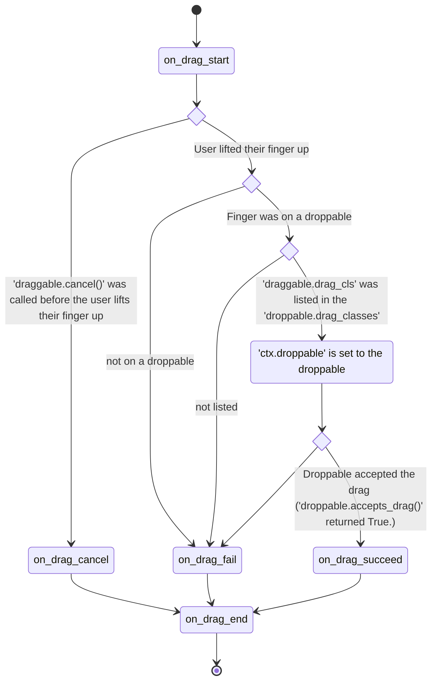

# Draggable

Drag & Drop functionality for Kivy widgets.

  
* [Youtube][youtube] (Current APIs are drastically different from those shown in the videos)  
* [README(Japanese)](https://github.com/kivy-garden/draggable/blob/main/README_jp.md)  
* Inspired by [drag_n_drop][drag_n_drop] and Flutter's [Draggable][flutter]

## Installation

```
$ pip install "kivy-garden-draggable @ git+https://github.com/kivy-garden/draggable.git@v0.4"
```

## Usage


- Drag is triggered by a long-press. More precisely, when a finger of the user
  dropped inside a draggable, if the finger stays for `draggable.drag_timeout`
  milli seconds without traveling more than `draggable.drag_distance` pixels, it will
  be recognized as a dragging gesture.
- Droppables can handle multiple drags simultaneously.
- Drag can be canceled by calling `draggable.drag_cancel()`.
- Nested `KXReorderableBehavior` is not officially supported. It may or may
  not work depending on how `drag_classes` and `drag_cls` are set.

## Flow

Once a drag has started, it will go through the following path.



## Cancellation

When your app switches a scene, you may want to cancel all ongoing drags.

```python
from kivy_garden.draggable import cancel_active_drags
cancel_active_drags()
```

## Using other widgets as an emitter

Let's say you are creating a card game, and there is a deck on the screen.
Say, you want the deck to emit a card when the user drops a finger on it,
and want the card to follow the finger until the user lifts it up.
In this situation, a widget that triggers a drag and a widget that is dragged are different.
You can implement it as follows:

```python
import asynckivy as ak
from kivy_garden.draggable import perform_drag

class Deck(Widget):
    def on_touch_down(self, touch):
        if self.collide_point(*touch.opos):
            card = Card(...)
            ak.managed_start(perform_drag(card, touch))
```

## License

This software is released under the terms of the MIT License.

[drag_n_drop]:https://github.com/kivy-garden/drag_n_drop
[flutter]:https://api.flutter.dev/flutter/widgets/Draggable-class.html
[youtube]:https://www.youtube.com/playlist?list=PLNdhqAjzeEGiepWKfP43Dh7IWqn3cQtpQ
